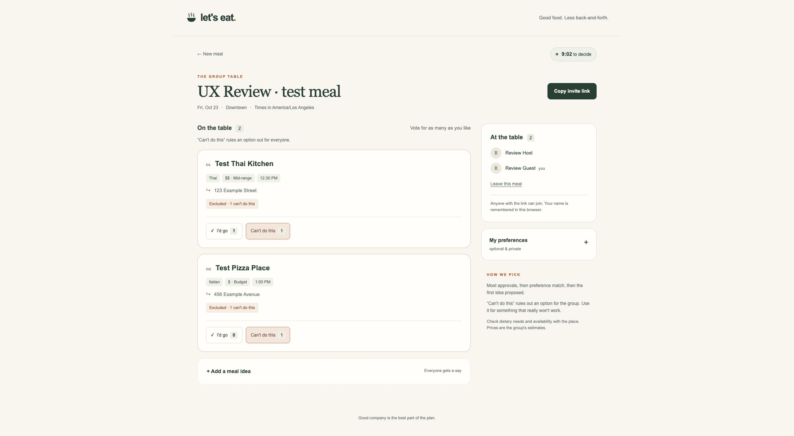
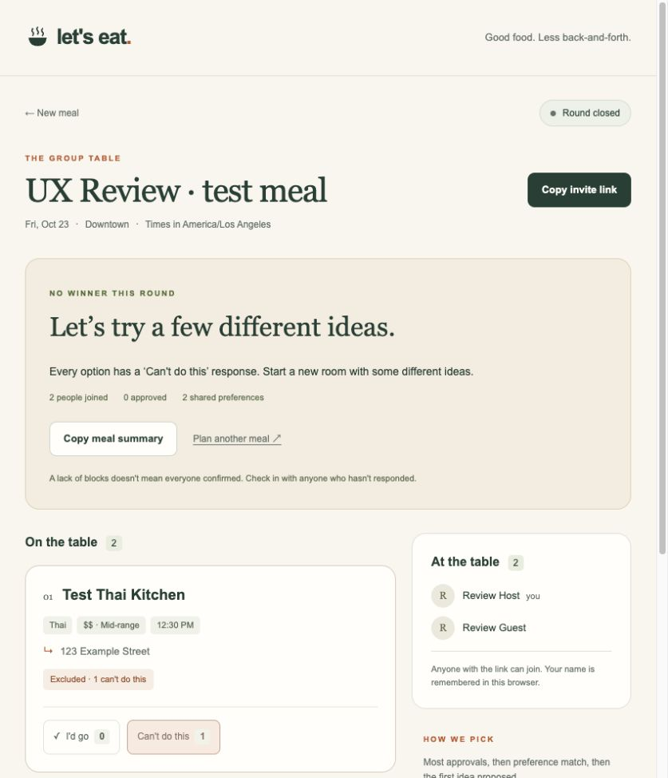

# Let's Eat — Product and UX Review

Reviewed on October 22, 2026 (America/Los_Angeles).

App: [Let's Eat](http://24.130.34.221:3000/)

The visual design and basic flows are cohesive. The biggest opportunities are to help groups recover from disagreement, reach a decision sooner, and reduce the organizer's setup effort.

## Review scope

This review is based on hands-on testing of the deployed app, rather than a source-code review. A room labeled **UX Review · test meal** was created with fictional restaurants. Testing covered:

- Room creation and joining from two independent browsers.
- Voting, vetoes, and basic synchronization between browsers.
- Saving preferences and retaining identity, votes, preferences, and the countdown after a refresh.
- Validation of a past meal date and an invalid preferred time range.
- A narrow mobile viewport.
- Natural expiration of the full ten-minute round with every option vetoed.

The checks for invalid dates and time ranges behaved as expected, and the basic persistence checks passed. A successful winner-selection outcome, backend concurrency, authorization, and recovery from network interruptions were not verified.

## 1. High priority: Recover from disagreement within the same room

**Observed:** When both meal options received a “Can't do this” response, each card displayed an “Excluded” label, but the countdown continued without a prominent room-level conflict message. At expiration, the app correctly displayed “NO WINNER THIS ROUND.” The available recovery action, “Plan another meal,” led to the home page. There was no visible way to add alternatives or reopen the existing room after it closed.

**Why it matters:** The group can spend the entire decision window on options that are already known to be infeasible, then has to start over. This makes the most difficult group situation the most expensive one to recover from.

**Suggested improvement:**

- Show a prominent “No viable options right now” message as soon as all options are excluded.
- Offer a direct action to propose another option while the round is still open.
- Allow a new round in the same room after expiration, preserving participants and preferences while resetting the round's votes.

**Evidence: All options excluded before the deadline**

**Evidence: Expired round requires starting another meal**

## 2. High priority: Support completion before the fixed deadline

**Observed:** The ten-minute countdown starts immediately when the room is created. No visible “I'm done,” “Finish voting,” or early-finalization control was available in the tested room.

**Why it matters:** This can make a group wait even after it reaches agreement. The countdown also starts before the organizer has finished distributing the invitation.

**Suggested improvement:** Add an explicit “I'm done” action and a response count such as “2 of 3 people have responded.” Let the group finalize early once everyone is ready. If an organizer can close a round early, make the participation status clear before confirmation.

## 3. Medium priority: Reduce the organizer's setup effort

**Observed:** The initial form presents a name, meal title, date, area, timezone disclosure, and an option containing place name, location, start time, cuisine, price, and an optional link. Some fields have defaults, but multiple options still require repeated entry of restaurant details.

**Why it matters:** A product promising less planning asks the organizer to do a substantial amount of preparation before the shared link exists.

**Suggested improvement:** Keep the initial path focused on the organizer's name, meal date/time, and a first idea. Move secondary restaurant details into an optional disclosure. Consider allowing the organizer to create the room first and add ideas with the group. Link-based restaurant autofill could be a later enhancement.

## 4. Medium priority: Make vetoes useful for finding an alternative

**Observed:** A single “Can't do this” response excludes an option for everyone. The interface explains this rule, but it does not collect a reason for the constraint.

**Why it matters:** Other participants know that an option will not work, but cannot tell which part of the proposal to change.

**Suggested improvement:** Preserve hard vetoes and offer optional reason tags such as “Time conflict,” “Dietary restriction,” “Too far,” or “Over budget.” Keep ordinary taste preferences separate from hard constraints. Reasons should help the group propose a viable next option without requiring a chat feature.

## 5. Medium priority: Put voting closer to the top on mobile after joining

**Observed:** On a narrow mobile viewport, the first-time join form moves ahead of the meal options, which helps onboarding. After joining, the participant list and preferences still appear ahead of the voting cards.

**Why it matters:** A returning or newly joined participant must scroll past supporting information to reach the primary action.

**Suggested improvement:** After joining, prioritize the meal options. Collapse the participant list into a compact status row and keep preferences accessible through a small optional control. Show who has responded, rather than only who has joined.

## 6. Medium priority: Make the result flow quick to evaluate

**Observed:** A complete timed walkthrough requires waiting through the fixed ten-minute round, making it slow to explore the final result and its explanation.

**Why it matters:** A reviewer should be able to experience voting, see which meal wins, and understand why within a short walkthrough.

**Suggested improvement:**

- Add a clearly labeled **Try a demo** entry point with sample meal options and participant inputs already filled in.
- Let the reviewer try a vote and click **Show result** immediately to see the winning meal and decision explanation. Include a sample all-excluded outcome to demonstrate the no-winner flow too.
- Keep sample data and demo actions separate from real rooms. Normal rooms retain their ten-minute deadline and existing decision rules.

**Acceptance:** From the home page, a reviewer can reach and understand a sample result in under one minute, without entering restaurant details or waiting for a real deadline. The interface clearly identifies the experience as a demo.

**Scope clarification:** The user has no DNS configured and accepts the current HTTP address and port. Raw-IP hosting is not an improvement request for this item; a domain or HTTPS deployment change is not required to deliver the faster demo.

## Decisions to explain in APPROACH.md

The submission would benefit from an explicit rationale for:

- Using hard vetoes for group constraints.
- Using preferences only as a tie-breaker rather than as a replacement for explicit votes.
- Choosing a ten-minute decision window and deciding when it begins.
- Selecting a result when nobody votes, including how a recommendation differs from a confirmed plan.
- Handling the case where every proposed option is infeasible.

These are product decisions to document and refine. This review does not establish implementation defects in the uninspected backend.
